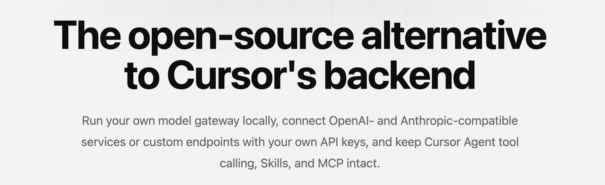
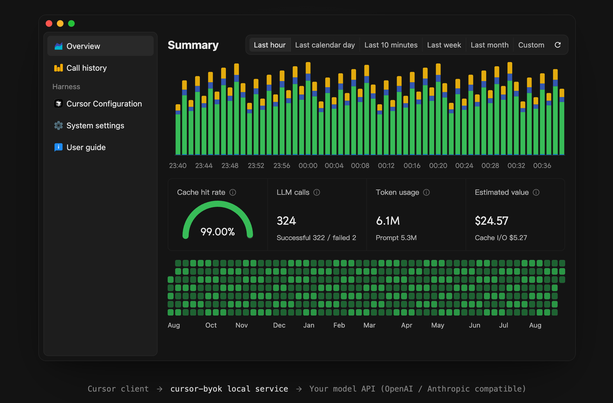
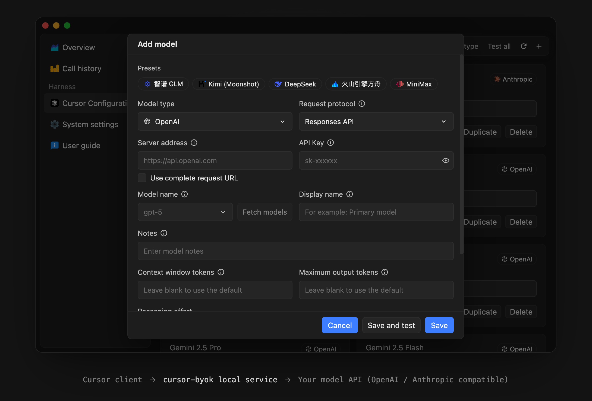

<div align="center">

# cursor-byok

cursor-byok 是一个运行在本机的 Cursor 模型网关，帮助你在 Cursor 中使用自己配置的模型服务。

[English README](./README.md) · [下载](https://github.com/baichuan335/cursor-byok/releases/latest) · [使用方法](#快速开始) · [提交问题](https://github.com/baichuan335/cursor-byok/issues)

[](https://github.com/baichuan335/cursor-byok/releases/latest)
[](https://github.com/baichuan335/cursor-byok/releases)
[](./LICENSE)
[](https://github.com/baichuan335/cursor-byok/releases/latest)

</div>





## 项目简介

cursor-byok 是一个开源的本地模型网关。它在你的设备上运行服务，接收 Cursor 发出的 Agent 请求，将请求转发到你配置的模型服务，并尽可能保留 Cursor Agent 的工具调用、Skills、MCP 和多轮对话能力。

你可以连接兼容 OpenAI 或 Anthropic 协议的服务，自定义服务地址、模型 ID、API Key 和请求参数，也可以使用 Cursor 平台默认选项之外的模型通道。

本仓库由 [baichuan335](https://github.com/baichuan335) 基于 [leookun/cursor-byok](https://github.com/leookun/cursor-byok) 继续二次开发和维护，保留原作者署名与 MIT 许可证。

> [!IMPORTANT]
> cursor-byok 免费且开源，但你连接的模型服务商可能会按用量收费。本项目不提供免费模型额度，也不解锁 Cursor 官方付费功能。本项目与 Cursor 或其开发者没有关联，也未获得其认可。

## 主要功能

- **自定义模型通道**：配置自己的 API 地址、凭据和模型 ID。
- **多种 API 协议**：支持 OpenAI Responses API、OpenAI Chat Completions API 和 Anthropic Messages API 兼容服务。
- **模型管理**：添加、复制、编辑、排序和分组模型配置，获取模型列表并批量测试连接。
- **连接测试与调用详情**：测试模型连通性，查看调用状态、响应耗时，并按需记录详细请求与响应。
- **Agent 工作流**：适配后端 Agent 流程中的工具调用和多轮对话，具体能力取决于模型与 Cursor 客户端兼容性。
- **会话指标**：查看 Token 用量、缓存命中率和按配置单价估算的费用。
- **Commit 与 TAB 设置**：选择提交信息生成模型和提示词，单独配置 TAB 服务的连接方式。
- **本机 API**：使用独立访问密钥，让其他本机应用调用已配置的模型。
- **跨平台桌面应用**：提供 Windows x64、macOS Apple Silicon / Intel 和 Linux x64 安装包。

## 快速开始

### 下载与安装

从 [GitHub Releases](https://github.com/baichuan335/cursor-byok/releases/latest) 下载适合你操作系统的安装包，并阅读对应版本说明：

| 平台 | 安装包 |
| --- | --- |
| Windows x64 | `.exe` 安装程序；运行需要 WebView2 Runtime |
| macOS Apple Silicon（M 系列） | 文件名包含 `aarch64` 的 `.dmg` |
| macOS Intel | 文件名包含 `x64` 的 `.dmg` |
| Linux x64 | Debian / Ubuntu 类系统使用 `.deb`，或使用兼容环境下的 `.AppImage` |

macOS 下载包未做 Apple 开发者签名或公证，系统可能显示安全提示。请确认下载来源并按发布页提供的 SHA-256 核对文件，不要全局关闭系统安全保护。AppImage 使用前需要赋予执行权限。

### 配置并使用

1. 保存 Cursor 中的工作，启动 cursor-byok，打开侧边栏 **模型配置 → Cursor**。
2. 按提示点击 **初始化 CA**，完成本机证书信任操作。CA 用于本地 HTTPS 代理，请勿分享其私钥。
3. 点击 **添加模型**，填写模型类型、服务地址、API Key 和模型名称，保存后运行 **测试**。
4. 测试通过后，打开 **开启接管Cursor** 开关，确认状态显示 **已接管**。接管可能结束 Cursor 进程，请提前保存工作。
5. 重新打开 Cursor，在模型列表中手动选择已配置的模型，发送一条简短消息。
6. 在 **调用详细** 中查看请求状态与用量。使用本地模型时，请保持 cursor-byok 运行。

要停止使用本地代理，请先在 Cursor 配置页关闭接管，再退出应用。下载和升级请以本仓库 Releases 为准，具体安装注意事项见对应发布说明。

> [!TIP]
> **Auto 不会自动选择你配置的本地模型**。你可以继续使用原会话，不必先删除或新建会话；若客户端提示继续或恢复，请先在原会话中操作。

## 模型配置

每个模型配置都是独立的上游通道，可以单独设置服务商、协议、凭据和生成参数。



### 类型与协议选择

| 服务接口 | 模型类型 | 请求协议 |
| --- | --- | --- |
| Anthropic 兼容接口 | **Anthropic** | Messages API |
| OpenAI Responses 兼容接口 | **OpenAI** | Responses API |
| OpenAI Chat Completions 兼容接口 | **OpenAI** | Chat Completions API |

按服务商实际提供的接口选择协议，不要仅根据模型名称判断。接口参数、缓存统计和工具调用支持可能因服务商而异。

### 常用字段

- **服务器地址**：填写服务商基础地址，由应用追加标准端点；也可以启用完整请求 URL 选项，原样使用指定地址。
- **API Key**：填写上游模型服务的访问密钥，区别于本机外部 API 的访问密钥。
- **模型名称**：填写服务商接受的模型 ID，也可以使用 **获取模型** 查询对方返回的列表。
- **显示名称与备注**：用于模型列表展示，不会改变发送给上游的模型 ID。
- **上下文与输出上限**：按模型能力设置上下文窗口 Token、最大输出 Token。
- **生成参数**：按需设置推理或思考强度、自定义 Headers，以及 OpenAI / Anthropic 额外参数。

自定义 Headers 和额外参数必须是 JSON 对象，只应填写服务商明确支持的字段。保存后运行 **测试**，再用小任务验证流式响应、工具调用和所用参数是否兼容。

## TAB 补全与其他设置

Cursor 的 Tab 补全由独立的 TAB 服务处理，不经过 Agent 模型通道。你可以在 **系统设置 → TAB 设置** 中选择：

- **使用公益服务**：使用预设的第三方公共服务，其可用性由服务提供方决定。
- **直连**：连接 Cursor 官方 TAB 服务，权限与额度由你的 Cursor 账号决定。
- **自定义**：填写兼容 TAB 接口的服务地址，普通聊天 API 地址不能直接替代 TAB 服务。

系统设置还提供 **Commit 提交代码模型设置**，可选择已配置的模型并编辑提示词，或选择「直连」使用 Cursor 官方服务。

**外部 API** 默认关闭。开启后，使用界面显示的本机基础地址和独立访问密钥调用已配置模型；不要将本机管理服务直接暴露到公网。

## 与官方账号并存

cursor-byok 可以将已配置的模型交给本地网关处理，并将未匹配本地配置的模型请求转发到 Cursor 上游。

- 本地模型和官方模型需在 Cursor 中分别选择。
- **Auto 使用官方模型**，不会因官方额度不足而自动切换到你的模型通道。
- 官方模型、TAB 直连及其他官方功能仍受账号权限、额度和服务策略限制。
- Cursor 自身的插件、Skills 和 MCP 由客户端管理，实际可用性取决于客户端、账号及模型兼容性。

## 数据流转

```text
Cursor 客户端
    │
    │ Agent 请求与工具结果
    ▼
cursor-byok 本地服务
    │
    │ OpenAI / Anthropic 兼容请求
    ▼
你配置的模型 API
```

API Key、模型配置和应用设置保存在本机。应用数据目录为当前用户主目录下的 `.cursor-byok-v3`；模型请求仍会发送到你选择的服务商，官方请求与 TAB 请求则按各自设置路由。

请根据服务商的隐私政策和计费规则使用。详细记录可能包含代码、对话或工具结果，不要公开上传数据库、CA 私钥、API Key 和未脱敏日志。界面中的费用为估算值，不是服务商账单。

## 常见问题

**连接一直等待或模型调用失败？**

先检查 CA 信任、接管状态、模型测试结果和 Cursor 中实际选择的模型，再检查服务商地址、请求协议、模型 ID 和网络代理。提交问题时请附上同一时间段的脱敏日志。

**旧会话提示运行流程不兼容？**

按 Cursor 提示在原会话中继续或恢复。若仍失败，保存工作，完全退出并重新启动 Cursor，打开原会话重新选择模型。无需先删除会话或清空数据库。诊断提示不等于恢复已成功，自动切换能否执行取决于客户端状态；项目不保证所有 Cursor 版本或会话都兼容。

## 项目结构

```text
cursor-byok/
├── apps/desktop/     # React 管理界面与 Tauri 桌面集成
├── server/           # Rust 网关、Agent 运行、管理 API 与 SQLite 存储
├── crates/           # 共享 Rust 库与代码搜索核心
├── protocols/        # Cursor 协议定义
├── support/          # 协议提取、抓包和基准测试工具
├── images/           # 项目展示图片
├── Cargo.toml        # Rust 工作区配置
└── Makefile          # 开发、检查和构建命令
```

## 本地开发

### 环境要求

- Git、Node.js / npm、Rust / Cargo。
- 对应系统的 [Tauri 2 构建依赖](https://v2.tauri.app/start/prerequisites/)。
- Windows 需要 Rust MSVC 工具链、Visual Studio C++ 构建工具、Windows SDK 和 WebView2 Runtime。

### 安装依赖与启动

```bash
git clone https://github.com/baichuan335/cursor-byok.git
cd cursor-byok/apps/desktop
npm ci
npm run tauri:dev
```

桌面开发环境会使用当前用户的应用数据和 Cursor 配置，不是隔离沙箱。

### 检查与构建

在 `apps/desktop` 中运行 `npm run check` 检查前端；在仓库根目录运行：

```bash
cargo fmt --all -- --check
cargo clippy --workspace --all-targets -- -D warnings
cargo test --workspace --all-targets
```

Windows 本地安装包可直接在 `apps/desktop` 中构建，无需 GNU Make：

```powershell
npm.cmd run tauri:build:local
```

默认输出位于仓库根目录的 `target/release/bundle/nsis/`。此命令关闭 updater 签名产物，不代表安装包具有 Windows 代码签名。macOS / Linux 构建需满足各自平台依赖；正式签名发布还需要维护者配置发布密钥。

安装了 GNU Make 的环境也可在仓库根目录使用 `make dev-web`、`make dev-desktop`、`make check`、`make build-server` 等命令。Windows CRLF 检出可能影响提示词模板的 LF 字符串断言，请结合测试输出排查。

## 社区与反馈

- [GitHub Issues](https://github.com/baichuan335/cursor-byok/issues)
- [下载与发布说明](https://github.com/baichuan335/cursor-byok/releases)
- [Pull Requests](https://github.com/baichuan335/cursor-byok/pulls)

提交问题时，请附上操作系统、Cursor 和 cursor-byok 版本、模型类型、请求协议、错误信息和复现步骤。请勿公开 API Key、私人代码或其他凭据。

## 参与贡献

欢迎提交 Issue 和 Pull Request。提交代码前请阅读 [AGENTS.md](./AGENTS.md)，并完成相关格式、测试和前端构建检查。版本变更和安装包说明请参阅 [Releases](https://github.com/baichuan335/cursor-byok/releases)。

## 作者与致谢

[](https://github.com/baichuan335)
[](https://github.com/leookun)

本仓库由 **baichuan335** 继续二开维护，基于 **leookun** 的 [cursor-byok](https://github.com/leookun/cursor-byok)。感谢原作者及所有项目贡献者。

## 许可证

本项目采用 [MIT License](./LICENSE) 开源，保留原始版权声明 `Copyright (c) 2026 leookun`。分发本软件或其实质部分时，须保留版权声明和许可声明；完整授权条件与免责声明以 LICENSE 为准。
