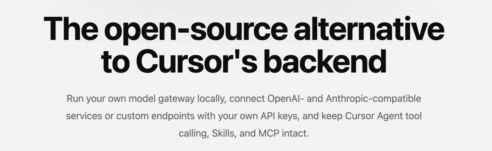
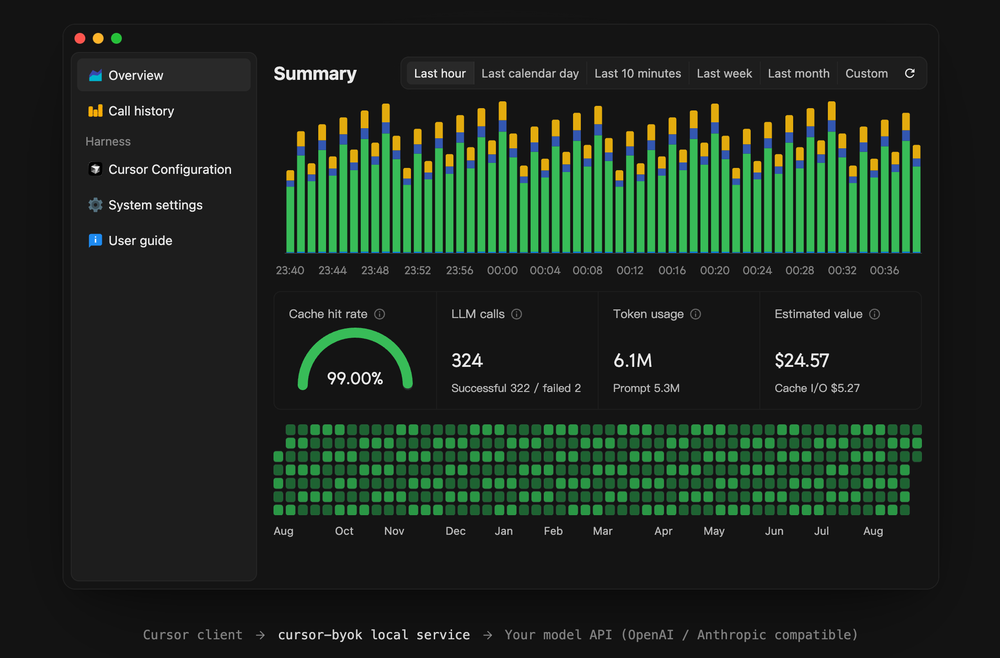
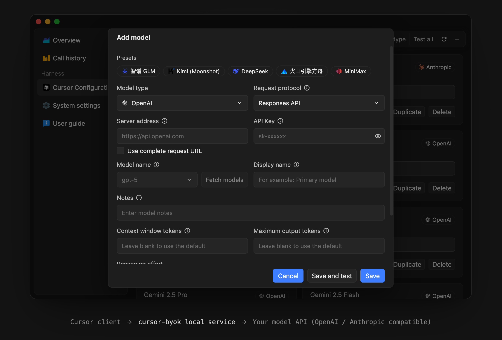

<div align="center">

# cursor-byok

cursor-byok is a local model gateway that lets you use your own model services in Cursor.

[简体中文](./README-CN.md) · [Download](https://github.com/baichuan335/cursor-byok/releases/latest) · [Getting started](#quick-start) · [Report an issue](https://github.com/baichuan335/cursor-byok/issues)

[](https://github.com/baichuan335/cursor-byok/releases/latest)
[](https://github.com/baichuan335/cursor-byok/releases)
[](./LICENSE)
[](https://github.com/baichuan335/cursor-byok/releases/latest)

</div>





## About

cursor-byok is an open-source local model gateway for Cursor. It runs a service on your machine, receives Cursor Agent requests, forwards them to your configured model services, and aims to preserve Cursor Agent tool calling, Skills, MCP, and multi-turn conversations.

You can connect OpenAI- and Anthropic-compatible services, customize endpoints, model IDs, API keys, and request parameters, and use model channels beyond the options built into the platform.

[baichuan335](https://github.com/baichuan335) continues development and maintenance of this derivative of [leookun/cursor-byok](https://github.com/leookun/cursor-byok), preserving original attribution and the MIT license.

> [!IMPORTANT]
> cursor-byok is free and open source, but the model APIs you connect may charge for usage. It does not provide free model credits or unlock paid Cursor features. This project is not affiliated with or endorsed by Cursor or its developers.

## Features

- **Bring your own model channels:** Configure your own API endpoint, credentials, and model IDs.
- **Multiple API protocols:** Use OpenAI Responses, OpenAI Chat Completions, and Anthropic Messages-compatible services.
- **Model management:** Add, duplicate, edit, reorder, and group configurations, discover models, and batch-test connections.
- **Connection tests and call details:** Test model connectivity, inspect call status and latency, and optionally record detailed requests and responses.
- **Agent workflows:** Adapt tool calls and multi-turn conversations in the backend Agent flow; capabilities depend on model and Cursor client compatibility.
- **Session metrics:** Track token usage, cache hit rate, and cost estimates using your configured rates.
- **Commit and TAB settings:** Choose a commit-generation model and prompt, and configure TAB routing separately.
- **Local API:** Let other applications on your machine call configured models using a separate access key.
- **Cross-platform desktop app:** Installers for Windows x64, macOS Apple Silicon / Intel, and Linux x64.

## Quick Start

### Download and install

Download the appropriate package from [GitHub Releases](https://github.com/baichuan335/cursor-byok/releases/latest) and read the notes for that version:

| Platform | Package |
| --- | --- |
| Windows x64 | `.exe` installer; WebView2 Runtime is required |
| macOS Apple Silicon (M-series) | `.dmg` with `aarch64` in the filename |
| macOS Intel | `.dmg` with `x64` in the filename |
| Linux x64 | `.deb` for Debian / Ubuntu-style systems, or `.AppImage` in a compatible environment |

Mac downloads are not Apple Developer signed or notarized and may trigger system security warnings. Verify the source and the SHA-256 checksums supplied on the release page; do not disable system security protections globally. AppImages require execute permission before use.

### Configure and use

1. Save your Cursor work, launch cursor-byok, and open **Models → Cursor** in the sidebar.
2. Click **Initialize CA** when prompted and complete the local certificate trust instructions. The CA is used for the local HTTPS proxy; do not share its private key.
3. Click **Add model**, enter its type, endpoint, API key, and model ID, save, then run **Test**.
4. After the test passes, enable **Enable Cursor takeover** and confirm the status is **Taken over**. Takeover may terminate Cursor processes, so save your work first.
5. Reopen Cursor, manually select the configured model, and send a short message.
6. Check its request status and usage in **Call history**. Keep cursor-byok running while using local models.

To stop using the local proxy, disable takeover on the Cursor page before quitting the app. Use this repository's Releases for downloads and upgrades; version-specific installation notes belong on the corresponding release page.

> [!TIP]
> **Auto does not automatically select your local models.** You can continue an existing conversation without deleting it or creating a new one. If the client prompts you to continue or resume, try that in the original conversation first.

## Model Management

Each configuration is an independent upstream channel with its own provider, protocol, credentials, and generation settings.



### Model type and protocol

| Service API | Model type | Request protocol |
| --- | --- | --- |
| Anthropic-compatible | **Anthropic** | Messages API |
| OpenAI Responses-compatible | **OpenAI** | Responses API |
| OpenAI Chat Completions-compatible | **OpenAI** | Chat Completions API |

Select the protocol according to the API your provider actually exposes, not the model name alone. Parameter support, cache reporting, and tool calling can vary by provider.

### Common fields

- **Server URL:** Enter a base URL and let the app append the standard endpoint, or enable the complete-request-URL option to use an exact URL.
- **API key:** The upstream model provider's access key, distinct from the access key for the local external API.
- **Model ID:** An identifier accepted by the provider; use model discovery to query the list it returns.
- **Display name and notes:** Presentation in the model list; these do not change the upstream model ID.
- **Context and output limits:** Set the context window and maximum output tokens according to the model's capabilities.
- **Generation settings:** Configure reasoning or thinking options, custom headers, and extra OpenAI / Anthropic parameters as needed.

Custom headers and extra parameters must be JSON objects containing only supported fields. Run **Test** after saving, then use a small task to check streaming, tool calls, and the parameters you need.

## TAB and Other Settings

Cursor Tab completions use a separate TAB service rather than an Agent model channel. Under **System settings → TAB Settings**, choose:

- **Public service:** Use the preset third-party public service; availability depends on its operator.
- **Direct:** Connect to Cursor's official TAB service, subject to your account's access and credits.
- **Custom:** Enter a service URL implementing compatible TAB endpoints. An ordinary chat API cannot directly replace a TAB service.

System settings also provides **Commit Settings**. Choose a configured model and edit its prompt, or choose **Direct** to use Cursor's official service.

The **External API** is disabled by default. When enabled, use the displayed local base URL and a separate access key to call configured models. Do not expose the local management service directly to the internet.

## Coexisting with Official Accounts

cursor-byok can route configured models through the local gateway and forward unmatched model requests to Cursor upstream.

- Select local and official models explicitly in Cursor.
- **Auto uses official models** and does not switch to your model channels when official credits run out.
- Official models, direct TAB connections, and other official features remain subject to account access, credits, and service policies.
- Cursor manages its own plugins, Skills, and MCP; availability depends on the client, account, and model compatibility.

## How It Works

```text
Cursor client
    │
    │ Agent requests and tool results
    ▼
cursor-byok local service
    │
    │ OpenAI- / Anthropic-compatible requests
    ▼
Your model API
```

API keys, model configurations, and application settings are stored locally. The application data directory is `.cursor-byok-v3` under the current user's home directory. Model requests still go to your chosen provider; official and TAB requests follow their respective routing settings.

Follow your providers' privacy policies and billing rules. Detailed records may contain code, conversations, or tool results. Do not publicly upload databases, CA private keys, API keys, or unsanitized logs. Cost figures are estimates, not provider invoices.

## Troubleshooting

**Requests stall or model calls fail?**

Check CA trust, takeover status, model test results, and the model selected in Cursor first. Then check the provider URL, protocol, model ID, and network proxy. Include sanitized logs from the same time when reporting a problem.

**An existing conversation reports runtime incompatibility?**

Continue or resume in the original conversation when Cursor prompts you. If it still fails, save your work, fully quit and restart Cursor, reopen the conversation, and select the configured model again. You do not need to delete conversations or clear the database first. A diagnostic notice does not confirm successful recovery; automatic rerouting depends on client state. Compatibility is not guaranteed for every Cursor version or conversation.

## Project Structure

```text
cursor-byok/
├── apps/desktop/     # React management interface and Tauri desktop integration
├── server/           # Rust gateway, Agent execution, control API, and SQLite storage
├── crates/           # Shared Rust libraries and code-search core
├── protocols/        # Cursor protocol definitions
├── support/          # Protocol extraction, capture, and benchmark tools
├── images/           # Project presentation images
├── Cargo.toml        # Rust workspace configuration
└── Makefile          # Development, checks, and build commands
```

## Local Development

### Prerequisites

- Git, Node.js / npm, and Rust / Cargo.
- [Tauri 2 build dependencies](https://v2.tauri.app/start/prerequisites/) for your system.
- On Windows: the Rust MSVC toolchain, Visual Studio C++ Build Tools, Windows SDK, and WebView2 Runtime.

### Install dependencies and start

```bash
git clone https://github.com/baichuan335/cursor-byok.git
cd cursor-byok/apps/desktop
npm ci
npm run tauri:dev
```

The desktop development environment uses the current user's application data and Cursor configuration; it is not an isolated sandbox.

### Checks and builds

Run `npm run check` in `apps/desktop` for frontend checks. From the repository root, run:

```bash
cargo fmt --all -- --check
cargo clippy --workspace --all-targets -- -D warnings
cargo test --workspace --all-targets
```

For a local Windows installer, run this in `apps/desktop` without GNU Make:

```powershell
npm.cmd run tauri:build:local
```

The default output is under `target/release/bundle/nsis/` at the repository root. This command disables updater signature artifacts; it does not establish Windows code signing for the installer. macOS / Linux builds require their own platform dependencies, and signed releases require maintainer-provided signing keys.

With GNU Make installed, you can also use `make dev-web`, `make dev-desktop`, `make check`, and `make build-server` from the repository root. Windows CRLF checkout can affect LF-only assertions in prompt-template tests; inspect the test output when troubleshooting.

## Community and Support

- [GitHub Issues](https://github.com/baichuan335/cursor-byok/issues)
- [Downloads and release notes](https://github.com/baichuan335/cursor-byok/releases)
- [Pull Requests](https://github.com/baichuan335/cursor-byok/pulls)

Include your operating system, Cursor and cursor-byok versions, model type, protocol, error message, and reproduction steps when reporting a problem. Do not disclose API keys, private code, or other credentials.

## Contributing

Issues and pull requests are welcome. Read [AGENTS.md](./AGENTS.md) before submitting code and complete the relevant formatting, test, and frontend build checks. See [Releases](https://github.com/baichuan335/cursor-byok/releases) for version changes and installer notes.

## Authors and Acknowledgements

[](https://github.com/baichuan335)
[](https://github.com/leookun)

**baichuan335** maintains this derivative of **leookun**'s [cursor-byok](https://github.com/leookun/cursor-byok). Thanks to the original author and all project contributors.

## License

This project is open source under the [MIT License](./LICENSE), retaining the original notice `Copyright (c) 2026 leookun`. Copies or substantial portions of the software must include the copyright and permission notices. See LICENSE for the full terms and disclaimer.
